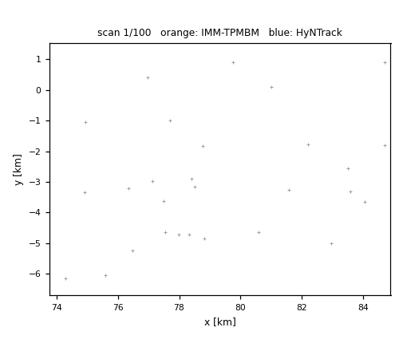

# HyNTrack

**HyNTrack: Enhancing TPMBM with Hypothesis-Conditioned Neural Recursion**

*One Monte Carlo run in a six-target scenario (λc = 15): gray lines are the
ground truth, gray crosses are measurements, orange lines are IMM–TPMBM
estimates, and blue lines are HyNTrack estimates.*

---

> **Note:** The source code, data, and evaluation scripts for this project are
> currently withheld while the accompanying paper is under peer review.
> **The full code will be made publicly available here upon acceptance.**
